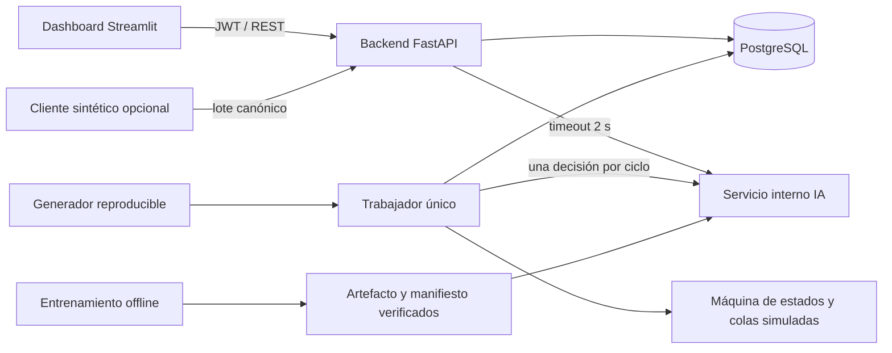

# FASE 2. Desarrollo e implementación del sistema

| Control documental | Valor |
|---|---|
| Identificador | SGT-CDMX-IMP-002 |
| Versión | 0.2.0 |
| Fecha | 31 de octubre de 2026, America/Mexico_City |
| Línea base | FASE_1_Documento_Tecnico_Trafico_CDMX.md, versión 1.0 |
| Entrega | Código base funcional, esquema, entrenamiento, simulación, dashboard y verificación |
| Entorno | Académico; cinco cruces sintéticos independientes NS/EO/PEATON |
| Equipo | Líder/Backend, Frontend, IA/Data Science, QA/Soporte |

## 1. Alcance implementado y decisiones

La implementación conserva la separación **observación → pronóstico de llegadas → política
restringida → aplicación en simulador**. El Random Forest estima el promedio de llegadas por
minuto de las siguientes cinco ventanas. La asignación proporcional de verde es una heurística;
no constituye una optimización demostrada ni un parámetro vial reglamentario.

El MVP usa datos sintéticos y no necesita credenciales Waze. Waze documenta un feed GeoRSS
para socios y áreas autorizadas; su disponibilidad depende del acuerdo correspondiente.
El puerto offline `waze_adapter.py` conserva conteos y clima ausentes y no transforma una
velocidad en aforo. [Especificación oficial del feed Waze](https://support.google.com/waze/partners/answer/13458165?hl=en).

| Capa | Selección | Motivo y responsabilidad |
|---|---|---|
| Backend | Python 3.13 + FastAPI 0.121.3 + SQLAlchemy 2.0.44 | Contrato OpenAPI, validación, autorización y transacciones; LB |
| Persistencia | PostgreSQL 17 + psycopg 3.2.12 | FK, unicidad, índices parciales y triggers diferidos; LB |
| IA | scikit-learn 1.7.2, RandomForestRegressor + SimpleImputer | CPU, datos tabulares, pipeline persistido; IA |
| Dashboard | Streamlit 1.51.0 | Una interfaz conectada a la API para el equipo de cuatro; FE |
| Simulación | Python, paso 1 s; NumPy para demanda | Estados excluyentes, colas y llegadas reproducibles; LB + IA |
| Verificación | pytest, pytest-cov, GitHub Actions | Contratos, reglas, integración y regresión; QA |
| Empaquetado | Docker Compose | Servicios internos, salud y volúmenes; LB + QA |

Las versiones directas están en `requirements.txt`; `requirements.lock` fija también las
transitivas usadas. SQLite es un perfil auxiliar de demostración y pruebas rápidas. Las
restricciones diferidas específicas y la concurrencia se verifican adicionalmente con PostgreSQL.
No se incorporan React, TensorFlow ni PyTorch al MVP: no son necesarios para esta línea base.

## 2. Estructura del proyecto

```text
SistemaTrafico/
├── backend/
│   ├── app/
│   │   ├── config.py          # perfiles y secretos externos
│   │   ├── controller.py      # reparto, invariantes y máquina de fases
│   │   ├── database.py        # sesiones y UTC
│   │   ├── main.py            # FastAPI y autorización
│   │   ├── models.py          # entidades relacionales
│   │   ├── schemas.py         # contratos de entrada
│   │   ├── security.py        # Argon2 y JWT con expiración
│   │   ├── services.py        # ingesta, predicción, propuestas, auditoría
│   │   ├── simulation.py      # conservación de vehículos y esperas
│   │   └── waze_adapter.py    # normalización offline de feed autorizado
│   └── worker.py             # reloj, aplicación, fuente sintética y fallback
├── frontend/dashboard.py
├── ml_model/
│   ├── synthetic.py          # generación y contrato de atributos
│   ├── train_model.py        # dataset, particiones, CV, entrenamiento y métricas
│   ├── registry.py           # verificación de hash y carga
│   ├── service.py            # FastAPI interno de inferencia
│   ├── evaluate.py           # 50 comparaciones pareadas
│   ├── promote.py            # registro explícito de promoción/reversión
│   └── artifacts/            # datasets y modelos locales, fuera de Git
├── database/
│   ├── migrations/001_initial.sql
│   ├── constraints.sql       # integridad del conjunto de fases
│   ├── runtime_permissions.sql
│   └── manage.py             # migración versionada, catálogo y administrador
├── scripts/
│   ├── configure.py          # secretos aleatorios; no sobrescribe .env
│   ├── run_local.py          # lanza cuatro procesos locales
│   ├── simulate_waze.py      # cliente del generador canónico
│   ├── pert.py               # ruta crítica reproducible
│   ├── load_test.py          # perfil de carga parametrizado
│   ├── backup.py             # pg_dump sin contraseña en argumentos
│   └── build_metadata.py     # SQL, OpenAPI y bloqueo de dependencias
├── tests/                    # unidad, integración, PostgreSQL y simulador
├── docs/                     # Fases 1/2, manuales y trazabilidad
├── reports/                  # métricas, PERT y evidencias
├── .github/workflows/ci.yml
├── .env.example
├── Dockerfile
├── compose.yaml
├── requirements.txt
├── requirements.lock
└── README.md
```

## 3. Arquitectura ejecutable y límites de confianza



El dashboard consulta exclusivamente la API. La IA no recibe credenciales de BD ni aplica
fases. El trabajador es un proceso independiente: iniciar varios workers HTTP no crea varios
simuladores. Un arrendamiento global con heartbeat identifica al único trabajador; PostgreSQL
bloquea filas de intersección durante la decisión/aplicación. El perfil inicial no particiona la
propiedad entre múltiples trabajadores.

El backend registra propuestas en estado `PROPOSED`. `/apply` reserva una nueva versión
mediante `UPDATE ... WHERE plan_version=:expected`, y las deja `PENDING`. Solo el trabajador
las confirma `ACTIVE` al comenzar su ciclo objetivo. Una reserva simultánea o versión obsoleta
produce 409; la restricción única parcial impide dos planes activos o pendientes por cruce.

El tiempo de fuentes, ciclos y caducidad es simulado; la antigüedad de heartbeat y los timeouts
de cómputo usan reloj real. El frontend marca telemetría desconocida después de cinco segundos
sin heartbeat y no presenta los últimos colores como actuales.

## 4. SQL y modelo de persistencia

El archivo ejecutable completo es `database/migrations/001_initial.sql`, generado desde el
modelo ORM y complementado con `constraints.sql`. Contiene las tablas de Fase 1:

| Tabla SQL | Propósito y restricciones |
|---|---|
| intersecciones | Coordenadas válidas, activación, versiones de catálogo/plan y telemetría |
| grupos_movimiento | NS, EO, PEATON; código único por cruce, carriles y descarga positivos |
| semaforos | Cabezales únicos y pertenencia al grupo; colores derivados del controlador |
| registros_trafico | Histórico único por fuente/grupo/ventana; conteos y velocidad opcionales |
| usuarios | Correo único, hash Argon2, rol y activación |
| modelos | Versión única, hashes, metadatos, métricas y estado |
| predicciones | Flujo no negativo, horizonte 5 min, atributos y referencias de entrada |
| planes_semaforicos | Modo, estado, ciclo, versión previa, motivo, usuario y confirmación |
| detalles_plan | Tres fases, orden y tiempos por grupo |
| plan_prediccion | Trazabilidad muchos-a-muchos entre planes y pronósticos |
| auditoria | Actor, instante, antes/después, motivo y correlación |
| experimentos | Soporte para archivar configuración y métricas de experimentos |
| control_worker | Exclusión del trabajador de simulación |
| schema_versions | Versiones de migración aplicadas; creada por el inicializador PostgreSQL |

`registros_trafico` es el Historial de Tráfico solicitado; no hay una segunda tabla redundante.
Las columnas temporales son `TIMESTAMP WITH TIME ZONE` en PostgreSQL y las respuestas son
UTC ISO 8601. El dashboard convierte a America/Mexico_City. Los datos sintéticos usan
`source=synthetic`; el catálogo identifica expresamente los cruces como sintéticos.

El esquema valida dominios y referencias. Los triggers diferidos comprueban que un plan activo
tenga exactamente tres grupos del mismo cruce, secuencia correcta, tiempos de transición y suma
de 120 s. La aplicación repite esas validaciones antes de proponer/aplicar. Un `CHECK` aislado
por fila no se utiliza para simular una validación de suma entre varias fases.

Para PostgreSQL, `python -m database.manage` aplica la migración una sola vez y registra versión
1; inserta cinco cruces y el administrador sin duplicarlos. No modifica automáticamente un
esquema existente para cambios futuros: se deberá crear `002_...sql`, revisar sus efectos y
agregar su ejecución/versionado. En SQLite crea el esquema ORM equivalente para demostración.

Compose usa un propietario para inicializar y un rol `traffic_app` de ejecución. El rol de la
aplicación solo puede leer/insertar auditoría, no modificarla ni borrarla, y no administra usuarios.
La gestión de usuarios del MVP se realiza mediante inicialización administrativa; no hay CRUD
público de cuentas. Los experimentos y promociones también conservan archivos JSON versionables.

## 5. Datos sintéticos y entrenamiento

`python -m ml_model.train_model --days 90 --seed 42` crea 90 días × 1,440 minutos ×
5 cruces × 2 grupos de observaciones brutas. La tabla supervisada descarta las primeras cuatro
ventanas sin historial y las cinco últimas sin etiqueta por grupo. Genera picos de mañana/tarde,
efecto de día semanal, tres climas, incidentes, ruido autocorrelacionado y variación entre cruces.
Las llegadas no dependen del control elegido.

| Campo del pipeline | Unidad y disponibilidad |
|---|---|
| hour_sin, hour_cos | Hora cíclica local al instante de decisión |
| weekday | Día local 0–6 |
| weather | Clima sintético conocido: 0 despejado, 1 lluvia, 2 lluvia fuerte |
| last_vpm | Conteo de la última ventana completa de 60 s |
| mean5_vpm | Promedio de las cinco ventanas completas más recientes |
| speed_kmh | Velocidad sintética de la última ventana; no se infiere de colas reales |
| intersection, direction | Cruce sintético y NS/EO codificados |
| target_vpm | Etiqueta: promedio de conteos de las cinco ventanas siguientes |

Entrenamiento: días 1–54; validación: 55–72; prueba: 73–90. Todas las intersecciones comparten
los mismos cortes UTC. Se purgan etiquetas que crucen fronteras y se construyen atributos solo
con información disponible al decidir. Para contener recursos, se muestrean hasta 300,000 filas
del entrenamiento por bloques horarios con todos los cruces/grupos. Validación y prueba se
conservan completas. Dos profundidades se comparan con validación expansiva en entrenamiento
y separación de al menos cinco minutos; después se ajusta el candidato final sobre entrenamiento.

La imputación se ajusta dentro del pipeline, evitando ajustar transformaciones con la prueba.
Las etiquetas futuras no forman parte de las variables de inferencia. Este aislamiento sigue la
recomendación de scikit-learn sobre prevención de fuga.
[Buenas prácticas oficiales](https://scikit-learn.org/stable/common_pitfalls.html).

Se guardan dataset `.csv.gz`, pipeline `.joblib`, hashes SHA-256, versiones de entorno,
semilla, atributos, corte de entrenamiento, MAE/RMSE globales y por grupo. El orden de datos y
la compresión con `mtime=0` favorecen reproducción. Las pequeñas diferencias numéricas entre
plataformas se aceptan hasta `1e-6` veh/min en inferencia con las mismas dependencias; no se
exige identidad binaria de modelos entre entornos.

`registry.py` valida ruta, hash, versión de scikit-learn, atributos y estado antes de cargar.
Solo se admiten artefactos propios en un directorio administrado: joblib puede ejecutar código
al deserializar; el hash detecta cambios accidentales pero no autentica a un autor malicioso.
[Persistencia de modelos en scikit-learn](https://scikit-learn.org/stable/model_persistence.html).

## 6. Controlador y simulación

Cada ciclo contiene, en orden:

1. Verde NS, amarillo NS 3 s y despeje 2 s.
2. Verde EO, amarillo EO 3 s y despeje 2 s.
3. Verde peatonal exclusivo 20 s y despeje peatonal 10 s.

Los verdes vehiculares suman 80 s; cada uno está entre 20 y 60 s. La sugerencia es
`g_NS = clip(80*d_NS/(d_NS+d_EO),20,60)`, o 40 s si la suma es cero. Se limita el cambio
automático respecto al anterior a ±5 s, se redondea NS y se calcula EO como complemento.
Rojo vehicular = `120 - verde - 3`; con verde 40, rojo 77. No se entrenan verde/rojo
independientemente. El fallback fijo 40/40 puede exceptuar el límite de variación automática.

Las intervenciones requieren motivo y duran de uno a diez ciclos. No cambian el orden,
despejes ni oportunidad peatonal. Prioridad: invariantes → fallback por datos/IA → manual vigente
→ automático. El retorno al automático cancela intervenciones desde el siguiente ciclo.

Antes de adaptar, se requieren cinco observaciones consecutivas por acceso, conteos y velocidad
disponibles, clima conocido y última ventana con antigüedad no mayor de 120 s. La API conserva
observaciones tardías como histórico y distingue datos sin conteo. La deduplicación utiliza
fuente/grupo/inicio/fin. El lote devuelve aceptación, duplicado o rechazo por elemento.

El trabajador genera las llegadas exógenas por minuto y las distribuye en segundos mediante
semillas reproducibles. En cada paso se conserva `cola = llegadas acumuladas - salidas`.
Las salidas son enteras, están limitadas por vehículos disponibles y capacidad durante verde;
los amarillos no descargan en este modelo didáctico. No se acumula capacidad ociosa.

Ante caída de IA, el siguiente límite usa fijo. Ante caída de BD, el trabajador conserva estados
y continúa localmente, usando fallback en el siguiente límite. No acepta nuevas instrucciones
sin persistencia; el dashboard pierde confirmación y marca estado desconocido. Conserva hasta
10,000 observaciones por cruce en memoria y las reconcilia al recuperar BD, con auditoría del
intervalo y un ciclo fijo de recuperación. Si el buffer se llena, detiene ese reloj para no
perder observaciones silenciosamente. Si también cae el proceso, ese buffer volátil se pierde;
la recuperación arranca con diez segundos de despeje y registra el reinicio. No se declara una
garantía de durabilidad para telemetría que nunca fue aceptada en BD.

## 7. Backend y contratos

Las rutas están implementadas en `backend/app/main.py`; Swagger queda en `/docs`. Excepto
`/health` y `/auth/token`, requieren `Authorization: Bearer TOKEN`. Los permisos de escritura
se comprueban en servidor; un usuario `viewer` solo consulta. JWT vence tras una hora.

| Método y ruta | Contrato principal |
|---|---|
| POST /auth/token | Correo y contraseña → token; 401 si son inválidos |
| GET /intersections | Cruces, grupos, versiones, colas, modo y vigencia de telemetría; paginación |
| POST /intersections | Alta administrativa de cruce y tres grupos |
| PUT /intersections/{id} | Configuración, capacidad y activación con versión esperada |
| POST /traffic_records | Lote de 1–1,000 observaciones; resultado individual e idempotencia |
| GET /traffic_data | Cruce, grupo, inicio/fin, offset/limit; unidades, procedencia y antigüedad |
| POST /predict_light | Cruce y versión previa → propuesta persistida, demanda, verdes/rojos, modo y motivo |
| GET /plans/{id} | Estado persistido y confirmación del plan |
| POST /plans/{id}/apply | Versión y ciclo → 202 PENDING; aplicación diferida |
| POST /manual_override | Cruce, versión, verdes, motivo y vigencia; restricciones idénticas |
| POST /automatic | Solicitud de retorno al automático al siguiente ciclo |
| GET /audit | Antes/después, actor, motivo y correlación; consulta administrativa paginada |
| GET /health | Estado mínimo del proceso y alcance simulado |

Ejemplo de predicción usando observaciones persistidas; el cliente no inventa características
ni puede omitir fases en el cuerpo de la petición:

```http
POST /predict_light
Authorization: Bearer TOKEN
Content-Type: application/json

{"intersection_id":1,"previous_version":0}
```

Una respuesta normal identifica el plan, `status=PROPOSED`, `mode=automatic`, horizonte 5 min,
demanda de ambos accesos y verdes. Con demanda 30/10 y anterior 40/40 se propone 45/35,
rojos 72/82 y ciclo 120. Sin fuente o modelo válido devuelve `mode=degraded`, causa explícita y
40/40; no afirma haber realizado inferencia. Solicitar una propuesta nunca modifica colores.

Una solicitud de aplicación contiene `{"previous_version":0,"target_cycle":1}`. Devuelve
`PENDING`; `/plans/{id}` y la telemetría confirman posteriormente `ACTIVE` y `applied_at`.
Errores: 401 autenticación, 403 permisos, 404 inexistente, 409 concurrencia/integridad, 422
contrato, 503 trabajador/persistencia no disponibles. El commit de la sesión se ejecuta antes
de enviar la respuesta exitosa, para evitar confirmar cambios que luego fallen al persistir.

## 8. Dashboard

`frontend/dashboard.py` incluye sesión, selección de cruce, actualización cada dos segundos,
modo confirmado, colas, ciclo, reloj simulado, colores con texto, tabla de observaciones y gráfico
de demanda. Muestra origen y vigencia. Permite pedir una propuesta, intervenir con motivo y
vigencia, volver al automático y consultar auditoría. Las solicitudes pendientes no se presentan
como aplicadas. La exportación académica usa JSON con unidades y metadatos; no genera CSV
desde contenido arbitrario. No contiene credenciales de BD ni modifica el modelo.

## 9. Experimento y promoción

`evaluate.py` fija 10 semillas inéditas por cada uno de cinco escenarios: valle, pico,
desbalance, lluvia/incidente y sobresaturación. Cada par usa exactamente las mismas llegadas,
capacidad, transiciones y oportunidad peatonal. Se calienta 900 s y mide 7,200 s, con paso de 1 s.
Los pronósticos se calculan por lotes con las cinco ventanas anteriores a cada decisión;
precálculo no implica acceso a llegadas futuras.

Se reportan demora acumulada en veh·s, colas media/p95, salidas, pendientes finales y espera
de vehículos servidos. La demora integra las colas, incluidos vehículos que permanecen al final.
La métrica peatonal es el máximo rojo de la fase, no una espera individual calibrada. Los
intervalos remuestrean corridas pareadas dentro de cada escenario, manteniendo fija la mezcla
de escenarios; nunca remuestrean segundos correlacionados. Cada escenario usa diez semillas
distintas, fijadas antes de comparar y ajenas al entrenamiento; no se usan para ajustar el candidato.

La promoción exige 90 días, MAE al menos 10% menor que persistencia, protocolo completo,
reducción media de demora ≥10%, IC95% con límite inferior mayor que cero y p95 no más de 10%
peor en **cada** corrida no sobresaturada, además de cero conflictos/omisiones peatonales.
Requiere autor/revisor diferentes, motivo y correspondencia de hashes. La identidad del revisor
se registra procedimentalmente en el CLI, sin firma criptográfica ni directorio de identidades.
La revisión humana del equipo sigue siendo necesaria. `active.json` se reemplaza atómicamente
y el historial queda en `promotions.jsonl`. Reiniciar IA carga la nueva versión; para revertir se
selecciona una anterior con su misma evidencia. Un resultado negativo conserva la operación fija.

Los resultados observados están en `reports/model_evaluation.json`, `reports/experiment.json`
y `reports/VERIFICACION.md`. No se convierten en una afirmación de mejora en calles reales.

## 10. Ingeniería de software, riesgos y organización

Se conserva la adaptación de procesos de ISO/IEC/IEEE 12207:2026 de Fase 1. Su página oficial
describe procesos de ciclo de vida y aplicación iterativa sin imponer una metodología específica.
Esta entrega aporta evidencias de implementación/verificación; no declara certificación ni
conformidad exhaustiva sin acceso al texto autorizado y evaluación formal.
[ISO/IEC/IEEE 12207:2026](https://www.iso.org/standard/90219.html).

| Proceso adaptado | Evidencia de Fase 2 | Responsable/revisión |
|---|---|---|
| Requisitos y diseño | Línea base Fase 1, OpenAPI, matriz y reglas del controlador | LB / QA |
| Implementación/integración | API, IA, trabajador, BD, dashboard y Compose | Cuatro roles / revisión cruzada |
| Configuración | Dependencias fijadas, migración v1, hashes, semillas y manifiestos | LB + IA / QA |
| Verificación | pytest, CI, SQL real, cobertura y evidencias | QA / LB + IA |
| Validación | Comparación pareada y plan Alpha/Beta | IA + QA / representante académico |
| Operación y mantenimiento | Instalación, respaldo, reversión y retiro | QA + LB |
| Gestión de cambios | PR ligado a RF/RNF/RB, impacto en PERT, riesgos y documentación | LB / otro integrante |

Scrum conserva cinco sprints de dos semanas. CRISP-DM se materializa en generador/diccionario,
preparación temporal, referencia, entrenamiento, evaluación y despliegue mediante promoción.
La Definition of Done exige revisión, pruebas pertinentes, trazabilidad y documentación; una
ejecución automatizada no sustituye la revisión independiente de seguridad/control/experimentos.

| Rol | Área de trabajo | Entrega revisable |
|---|---|---|
| Líder/Backend | backend/, database/, Compose | Contratos, transacciones, seguridad y aplicación de planes |
| Frontend | frontend/ y contratos de consulta | Monitor, estados, vigencia e interacción |
| IA/Data Science | ml_model/ y generador | Dataset, modelo, ficha y comparación pareada |
| QA/Soporte | tests/, CI, reports/, manuales | Regresión, fallas, evidencia y aceptación |

Las estimaciones de Fase 1 permanecen hipótesis de planificación: 1,280 h-persona, 10 semanas
y $331,080 MXN. No se inventan horas consumidas ni se registra aceptación humana por el hecho
de generar código. `scripts/pert.py` recalcula TE=(To+4Tn+Tp)/6, varianzas, recorridos temprano/
tardío y holguras. Conserva la ruta A–B–C–E–H–J–K–L–N–O, **45 días hábiles**, varianza
2.7778 días² y cinco días de reserva. `reports/pert.json` contiene cada actividad. No se divide
la duración crítica entre cuatro desarrolladores ni se suman UCP y horas presupuestadas.

| Riesgo de Fase 1 | Tratamiento implementado | Evidencia / cierre pendiente |
|---|---|---|
| R-01 Waze no disponible | Fuente sintética obligatoria y puerto offline | Demo sin Waze; acceso real fuera del MVP |
| R-02 representatividad | Estacionalidad, clima, incidentes y cinco escenarios | Métricas sintéticas; calibración real excluida |
| R-03 fuga/sobreajuste | Cortes globales, purga, CV y persistencia | Pruebas de atributos/cortes y ficha del modelo |
| R-04 fases incompatibles | Máquina de estados, invariantes y trigger SQL | Batería automatizada; revisión humana por I=5 pendiente |
| R-05 fuente/IA/BD ausentes | Fijo, buffer local, transacciones y respaldo | Pruebas de falla; ejercicio operativo de restauración pendiente |
| R-06 acceso indebido | Argon2, JWT, permisos, secretos externos y rol restringido | Pruebas de autorización; revisión de dependencias/TLS pendiente |
| R-07 sobrecarga/ausencia | Módulos por rol, lanzador y manuales | Transferencia del equipo y capacidad por sprint pendientes |
| R-08 latencia/beneficio | Perfil de carga, experimento y rechazo de promoción | Informe experimental; carga completa pendiente |

No se reducen automáticamente las probabilidades ni se declara liberada la reserva residual de
$12,300 MXN: QA debe reconocer la evidencia de cada tratamiento. El seguimiento por sprint
registrará P/I, disparador, propietario y nueva EMV con el mismo mapeo de Fase 1.

## 11. Verificación, entrega y límites de aceptación

La prueba representativa solicitada está en
`tests/test_api.py::test_prediction_is_persisted_proposal_not_application`. Usa `TestClient`
con inferencia controlada y BD aislada; verifica 201, 45/35, rojo derivado, horizonte, persistencia
y ausencia de aplicación. Además se prueban permisos, idempotencia, entradas inválidas,
timeouts, datos viejos/ausentes, planes, peatones, colas, concurrencia y triggers PostgreSQL.
FastAPI documenta este uso de TestClient con pytest.
[Pruebas oficiales de FastAPI](https://fastapi.tiangolo.com/tutorial/testing/).

La matriz detallada, comandos y criterios Alpha/Beta están en `PRUEBAS_TRAZABILIDAD.md`.
La aceptación académica final requiere ejecutar carga 5/50 cruces, restauración, revisión de
dependencias y evaluación de cinco personas. Estas actividades no se confunden con la evidencia
automatizada ya registrada. Los parámetros de límites semafóricos permanecen los de la línea
base; modificarlos requiere un cambio revisado al controlador y sus pruebas. No se ofrece un
editor que permita alterar arbitrariamente las restricciones de fases.
