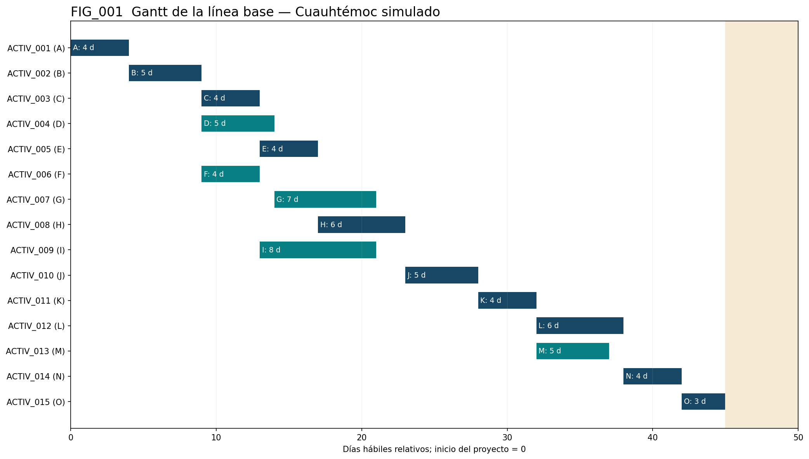
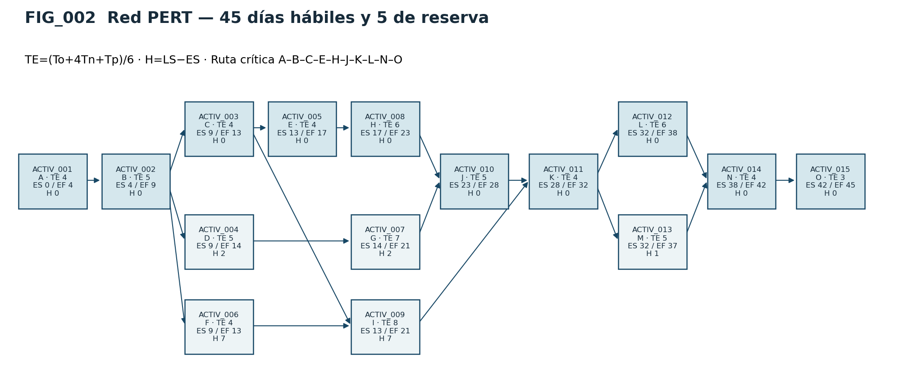
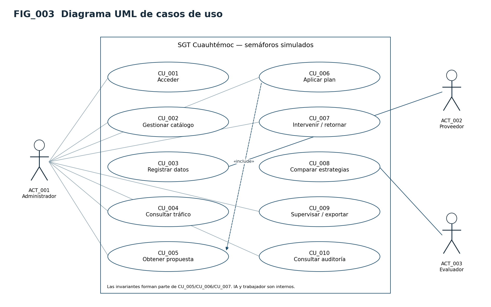
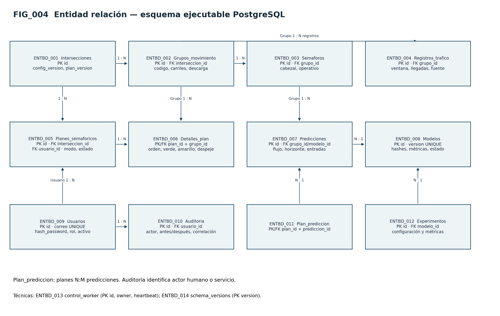
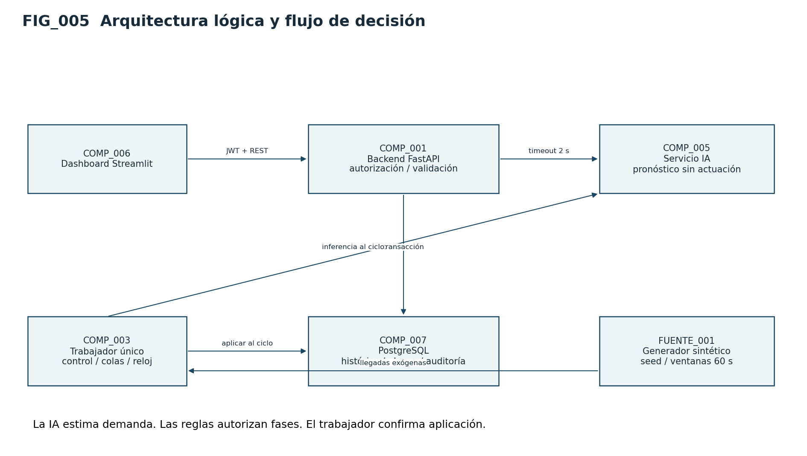
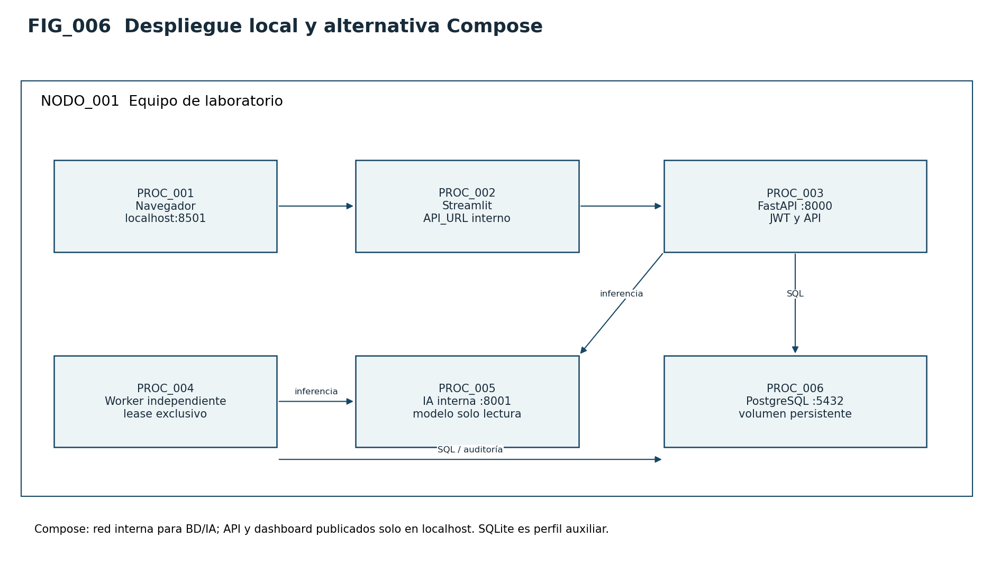

# DOC_001 Memoria técnica del sistema de semáforos simulados de Cuauhtémoc

Versión 1.0 · 1 de noviembre de 2026 · ENT_001. Proyecto académico para cuatro integrantes.

Esta memoria reúne descripción, fundamentos, análisis, diseño, desarrollo y verificación de un
prototipo que adapta semáforos **simulados** a la demanda vehicular pronosticada. El alcance es
ALC_001 Cuauhtémoc, con CUA_001 a CUA_005 sintéticos, sin aforos ni controladores físicos.
Los documentos DOC_002 a DOC_005 y figuras FIG_001 a FIG_006 forman parte de esta memoria.
La entrega documental está preparada; la aceptación por docente y evaluadores no se presume.
No se afirma certificación ISO. Los resultados de la línea base se identifican como sintéticos.

## IDX_001 Índice y numeración

Capítulo 2 Descripción general; capítulo 3 Marco teórico; capítulo 4 Análisis y diseño;
capítulo 5 Modelado; capítulo 6 Desarrollo; capítulo 7 Pruebas; anexos A a D.
Se corrigió la repetición de capítulo 5 de la lista recibida. Si una plantilla institucional exige
otra numeración, conservar los identificadores estables y cambiar solo los números de capítulo.

## CAP_002 Descripción general del proyecto

### DES_001 Descripción del sistema

Un plan fijo distribuye verde sin observar cambios de demanda. El prototipo estudia si anticipar
llegadas y repartir el verde de manera restringida reduce demora frente al mismo plan fijo.
Un generador emite observaciones por grupo y minuto; PostgreSQL conserva histórico; un modelo
pronostica cinco minutos; el controlador valida y el trabajador aplica al siguiente ciclo.
Streamlit permite consultar demanda, cola, colores, tiempos, alertas e intervenciones temporales.
La IA pronostica, no autoriza movimientos. La política no es una optimización matemática demostrada.
Las colas son resultado del simulador y no un campo recibido de Waze.

### OG_001 Objetivo general

Desarrollar y verificar un prototipo reproducible de gestión adaptativa de semáforos simulados
para un escenario académico de Cuauhtémoc, utilizando pronóstico de llegadas y una política
restringida, y comparar su desempeño con un plan fijo mediante experimentos pareados.

### OBJ_001 Objetivos específicos

**TAB_DOC_001_MEMORIA_001**

| ID | Objetivo | Evidencia de verificación |
|---|---|---|
| OE_001 | Representar cinco cruces NS/EO y peatones | Catálogo CUA_001..005 y prueba de inicialización |
| OE_002 | Generar llegadas reproducibles con clima y estacionalidad | Dataset, semilla y hash |
| OE_003 | Predecir promedio de llegadas de los próximos cinco minutos | MAE/RMSE temporal frente a persistencia |
| OE_004 | Aplicar ciclos válidos sin movimientos incompatibles | Propiedades y triggers PostgreSQL |
| OE_005 | Comparar demora/colas con plan fijo | Informe de 50 pares e intervalos por corrida |
| OE_006 | Supervisar y permitir intervención temporal | Dashboard y CU_007/CU_009 |
| OE_007 | Vincular requisitos, decisiones y pruebas | Matriz de trazabilidad y auditoría |

### ALC_001 Alcance y exclusiones

Cinco cruces independientes del escenario Cuauhtémoc, sin giros ni propagación entre cruces.
Las coordenadas son referencias esquemáticas: no son un inventario municipal ni una geocerca.
Se incluyen fuente sintética, API, IA, BD, control/simulación y dashboard. Se excluyen hardware,
cámaras, placas, prioridad de emergencias y coordinación de corredores. Una integración Waze
efectiva requiere autorización; el puerto entregado conserva ausentes los conteos/clima que el
feed no proporciona. Su ubicación central se usa como contexto del estudio, no como prueba
de representatividad de la demanda [REF_010].

### MET_001 Metodología y realización por etapa

Scrum organiza incrementos; CRISP-DM estructura el trabajo de datos. El backlog liga requisitos
y pruebas; el equipo planea por capacidad, inspecciona incrementos y ajusta prioridades. Se
planifican cinco sprints de dos semanas. No se inventan reuniones, asistencia ni actas históricas.
El líder mantiene prioridades, QA facilita seguimiento y los cuatro desarrollan/revisan [REF_002].

**TAB_DOC_001_MEMORIA_002**

| ID | Etapa CRISP-DM | Realización y artefacto |
|---|---|---|
| MET_002 | Comprensión del problema | OG_001, objetivos, hipótesis, alcance y comparación fija |
| MET_003 | Comprensión de datos | Unidades veh/min, calidad, estacionalidad y límites sintéticos |
| MET_004 | Preparación | Ventanas, atributos históricos, cortes temporales y purga |
| MET_005 | Modelado | Pipeline de imputación y Random Forest, dos profundidades y CV expansiva |
| MET_006 | Evaluación | Persistencia, MAE/RMSE y experimentos pareados; resultados negativos conservados |
| MET_007 | Despliegue | Manifiesto/hash, promoción revisada, servicio IA, fallback y reversión |

**TAB_DOC_001_MEMORIA_003**

| ID | Sprint planificado | Elementos y evidencia realizable |
|---|---|---|
| SPR_001 | Días 1–10 | Alcance, requisitos, riesgos y primeras observaciones |
| SPR_002 | Días 11–20 | Esquema, ingesta, referencia predictiva y contrato de dashboard |
| SPR_003 | Días 21–30 | API, control, entrenamiento e integración |
| SPR_004 | Días 31–40 | Fallas, pruebas, experimento y revisión de métricas |
| SPR_005 | Días 41–50 | Aceptación, manuales, transferencia; reserva días 46–50 |

Definición de terminado MET_008: revisión por otro integrante, pruebas pertinentes, documentación
y matriz actualizadas, sin defectos críticos abiertos. Autenticación, controlador y evaluación
requieren revisión cruzada. La generación de estos artefactos no acredita por sí sola esa revisión.

### NEG_001 Terminología del negocio

**TAB_DOC_001_MEMORIA_004**

| ID | Palabra | Significado dentro del sistema |
|---|---|---|
| TER_001 | Intersección | Cruce sintético con dos grupos vehiculares y una fase peatonal |
| TER_002 | Grupo | Movimientos compatibles NS, EO o peatones |
| TER_003 | Demanda | Vehículos que llegan por minuto, distintos de los que salen |
| TER_004 | Cola | Vehículos acumulados pendientes de servicio |
| TER_005 | Ciclo | Secuencia completa de fases de 120 segundos |
| TER_006 | Fase | Intervalo que autoriza un grupo compatible |
| TER_007 | Despeje | Intervalo sin autorización conflictiva antes de otra fase |
| TER_008 | Reparto de verde | Distribución de 80 segundos entre NS y EO |
| TER_009 | Pronóstico | Estimación del promedio de llegadas de los próximos cinco minutos |
| TER_010 | Plan fijo | Referencia vehicular 40/40, con peatones y transiciones |
| TER_011 | Plan adaptativo | Reparto calculado con pronóstico y restricciones |
| TER_012 | Degradado | Continuidad mediante plan fijo por datos o IA no disponibles |
| TER_013 | Intervención | Plan manual validado, con motivo y caducidad |
| TER_014 | Ventana | Observación completa de 60 segundos |
| TER_015 | Propuesta | Plan persistido aún no solicitado/aplicado |
| TER_016 | Pendiente | Aplicación reservada para un límite futuro de ciclo |
| TER_017 | Activo | Plan cuya aplicación fue confirmada por el trabajador |
| TER_018 | Trazabilidad | Vínculo de entrada, modelo, decisión, actor y prueba |
| TER_019 | Fuente sintética | Datos generados por algoritmo y semilla, sin medición vial |
| TER_020 | Waze | Fuente externa opcional autorizada; no equivale a aforo por acceso |

## CAP_003 Marco teórico

### TEOR_001 Flujo y capacidad vehicular

El flujo es una tasa de llegadas; la cola acumula demanda no atendida y la capacidad expresa
servicio posible. La distribución de verde afecta la oportunidad de descargar esa cola. Un
análisis vial real depende de geometría, movimientos, peatones y saturación; no basta conocer
el número total de vehículos. FHWA distingue estos conceptos en su manual histórico de
temporización; se usa como antecedente técnico, no como norma vigente de CDMX [REF_003].

En este modelo didáctico, cola siguiente = cola actual + llegadas − salidas. Las salidas son
enteras y no superan vehículos disponibles ni capacidad durante verde. Con tasa 0.5 veh/s y
40 s de verde hay hasta 20 oportunidades de servicio por ciclo. Con ciclo 120 s eso equivale
a 10 veh/min de capacidad media idealizada por grupo, sin representar una calibración de calle.
Demanda superior a capacidad hace crecer la cola: alargar un verde no crea capacidad infinita.

### TEOR_002 Control fijo y adaptativo

El control fijo mantiene repartos; el adaptativo responde a información de demanda. Aquí se
conserva el ciclo y se modifica únicamente su reparto vehicular. Una máquina de estados
codifica exclusión: NS verde/amarillo/despeje, EO verde/amarillo/despeje, peatones y despeje.
Verde NS + verde EO = 80; cada uno entre 20 y 60; peatones 20 y transiciones 20 adicionales.
Rojo vehicular = 120 − verde − 3. Son restricciones académicas de este simulador, no parámetros
reglamentarios. La aplicación al límite de ciclo separa cálculo de autorización efectiva.

### TEOR_003 Aprendizaje supervisado y regresión

Una observación de entrenamiento relaciona atributos conocidos X con una etiqueta futura y.
La regresión estima una cantidad continua. En este proyecto X contiene hora cíclica, día,
clima conocido, última demanda, media de cinco ventanas, velocidad y grupo; y es la media de
las cinco ventanas siguientes. Predecir colores sería otro problema y no es la formulación usada.
No se utilizan atributos futuros ni se deduce una cuenta vehicular a partir de velocidad.

### TEOR_004 Árboles y Random Forest

Un árbol divide el espacio de atributos mediante reglas y predice un valor por región. Random
Forest combina árboles entrenados con variación de muestras y atributos; en regresión agrega
sus predicciones. La diversidad reduce la sensibilidad frente a un solo árbol, pero no elimina
sesgo de datos o extrapolación. Profundidad, número de árboles y mínimo de muestras por hoja
controlan capacidad/costo. El pipeline conserva la transformación de entrenamiento para inferir
con el mismo contrato [REF_004]. La elección frente a Deep Learning responde a datos tabulares,
CPU y alcance de cuatro personas; no se afirma superioridad universal.

### TEOR_005 Dependencia temporal y fuga de información

Filas próximas comparten contexto. Separarlas al azar permite evaluar con información demasiado
cercana a entrenamiento. Se reservan días futuros comunes a todos los grupos y se purgan
etiquetas que crucen fronteras. La imputación se ajusta solo con entrenamiento. Son medidas
de aislamiento del experimento; validación final no debe reutilizarse indefinidamente para ajustar
el candidato [REF_005]. Persistencia predice con la media de las últimas cinco ventanas y
constituye una referencia explícita que la IA debe superar.

### TEOR_006 Métricas y experimento pareado

MAE = media de |y − predicción|; RMSE = raíz de la media del error cuadrático. Ambas se
expresan en veh/min; RMSE penaliza más errores grandes. La precisión del pronóstico no prueba
que un controlador reduzca demora. La evaluación de control integra colas en veh·s, cuenta
salidas y pendientes, y compara políticas bajo las mismas llegadas. Las semillas se fijan antes
del experimento. El intervalo bootstrap remuestrea corridas pareadas dentro de cada escenario,
no segundos autocorrelacionados. La inferencia solo describe las condiciones sintéticas ensayadas.

### TEOR_007 Ingeniería de software y persistencia

Los requisitos definen comportamiento verificable; los casos de uso describen interacciones;
los modelos de datos y arquitectura asignan responsabilidades. Transacciones, FK, unicidad y
versiones evitan estados contradictorios. Un índice parcial expresa un solo plan activo por cruce;
un trigger diferido valida el conjunto de fases al confirmar. El rol runtime no modifica auditoría.
Los hashes detectan alteraciones de artefactos, pero no autentican al autor si el directorio es
malicioso. Joblib solo debe cargar modelos propios y confiables [REF_006].

## CAP_004 Análisis y diseño

### ACTORES_001 Actores e interesados

**TAB_DOC_001_MEMORIA_005**

| ID | Actor o interesado | Relación con el sistema |
|---|---|---|
| ACT_001 | Administrador | Consulta, configura, interviene y revisa auditoría |
| ACT_002 | Proveedor de observaciones | Generador o adaptador externo autorizado; registra lotes |
| ACT_003 | Evaluador académico | Ejecuta evaluación y revisa reportes exportados |
| INT_001 | Conductores simulados | Generan demanda; no usan interfaz |
| INT_002 | Peatones simulados | Requieren fase exclusiva; no usan interfaz |
| INT_003 | Docente | Acepta entrega y limitaciones; no se atribuye aprobación automática |

El servicio IA, la BD y el trabajador están dentro del sistema. Los cuatro desarrolladores son
responsables del proyecto, no cuatro actores adicionales de interfaz. Proveedor sintético y Waze
son alternativas del mismo puerto; Waze efectivo permanece fuera del MVP sin autorización.

### REQ_001 Requerimientos funcionales

Todos los criterios son compromisos del prototipo propuesto y deberán comprobarse en Fase 2. «M» significa obligatorio y «S», deseable.

**TAB_DOC_001_MEMORIA_006**

| ID | Requerimiento | Prioridad | Criterio de aceptación resumido |
|---|---|---|---|
| RF_001 | Autenticar al administrador y restringir operaciones por permisos | M | Credenciales válidas permiten acceso; llamadas sin permiso devuelven 401/403 |
| RF_002 | Administrar intersecciones, grupos y parámetros | M | Alta/edición válida persiste; identificadores y configuraciones inválidas se rechazan |
| RF_003 | Generar escenarios sintéticos reproducibles | M | Misma semilla y versión producen las mismas llegadas exógenas |
| RF_004 | Registrar observaciones normalizadas | M | Guarda fuente, ventana, unidad, grupo y calidad; un duplicado no crea otra observación |
| RF_005 | Detectar datos inválidos, tardíos y ausentes | M | Rechaza negativos/imposibles; marca datos vencidos y no los usa como actuales |
| RF_006 | Consultar tráfico actual e histórico | M | Filtra por cruce y periodo; pagina y presenta fecha y procedencia |
| RF_007 | Predecir llegadas a cinco minutos | M | Devuelve valores no negativos, horizonte, modelo y condición de validez |
| RF_008 | Proponer un plan semafórico restringido | M | Satisface duración de ciclo, verdes, exclusión y transiciones; conserva motivo y versión |
| RF_009 | Aplicar planes en el simulador | M | Solo activa planes válidos en el límite de ciclo y registra la transición |
| RF_010 | Permitir intervención manual y retorno al automático | M | Solo administrador; exige motivo, duración y validación de las mismas restricciones |
| RF_011 | Activar y comunicar el modo degradado | M | Ante fuente vencida o IA indisponible activa el plan fijo al siguiente límite de ciclo |
| RF_012 | Visualizar estado, colas, demanda y alertas | M | Dashboard muestra dato, fecha, modo y estado; avisa si la información está desactualizada |
| RF_013 | Comparar plan fijo y adaptativo | M | Ejecuta escenarios pareados con las mismas llegadas y exporta métricas |
| RF_014 | Auditar decisiones y cambios | M | Cada cambio identifica actor, antes/después, momento, motivo y correlación |
| RF_015 | Versionar y promover modelos | M | Modelo, dataset, métricas y aprobación quedan ligados; permite revertir |
| RF_016 | Exportar resultados académicos | S | CSV/JSON con unidades y metadatos; se neutralizan fórmulas peligrosas en CSV |

### REQ_002 Requerimientos no funcionales

**TAB_DOC_001_MEMORIA_007**

| ID | Atributo | Especificación medible |
|---|---|---|
| RNF_001 | Rendimiento | API: p95 ≤ 500 ms para consultas y ≤ 1 s para predicción/plan, en prueba de 10 usuarios concurrentes, 10 minutos y cinco cruces, tras calentamiento |
| RNF_002 | Escalabilidad | Ensayo con 50 cruces, 100 grupos y una observación por grupo/minuto, sin pérdida de observaciones aceptadas y conservando RNF_001 bajo la misma concurrencia |
| RNF_003 | Moldeabilidad/modificabilidad | Cambiar límites o sustituir la fuente/modelo mediante configuración o adaptador, sin editar el controlador de fases; demostrarlo con un adaptador de prueba |
| RNF_004 | Resiliencia | La caída de IA no detiene la máquina de estados; detección en ≤ 5 s tras el timeout y activación de fallback en el siguiente ciclo, como máximo 120 s después |
| RNF_005 | Seguridad | Hash robusto de contraseñas, autorización en servidor, secretos fuera del repositorio y acceso externo cifrado; cero hallazgos críticos abiertos al entregar |
| RNF_006 | Integridad y tiempo | Transacciones y unicidad impiden planes activos duplicados y observaciones duplicadas; UTC en persistencia y America/Mexico_City en presentación |
| RNF_007 | Usabilidad y accesibilidad | Al menos 4 de 5 evaluadores completan consulta, identificación de alerta e intervención en ≤ 3 min por tarea, sin ayuda; estados con texto además de color |
| RNF_008 | Mantenibilidad | Cobertura de ramas ≥ 80% en validación/controlador, revisión por otro integrante y contratos de API documentados |
| RNF_009 | Reproducibilidad | Dataset, semillas, parámetros y dependencias fijadas permiten repetir el experimento; tolerancias numéricas documentadas |
| RNF_010 | Recuperación | RPO ≤ 24 h para datos persistidos y RTO ≤ 30 min en restauración de laboratorio; evidencia de un ejercicio de recuperación |
| RNF_011 | Observabilidad | Toda predicción y aplicación de plan es correlacionable con entrada, versión de modelo, tiempos y estado de fallback |
| RNF_012 | Transparencia | Dataset e interfaz identifican datos sintéticos; recomendaciones se presentan como heurísticas, sin afirmar optimalidad ni validación real |

El ensayo de 50 cruces evalúa capacidad informática, no coordinación vial. Las metas de latencia se medirán en una máquina de referencia de 4 núcleos lógicos y 8 GB de RAM, sin entrenamiento concurrente; se documentará el entorno efectivo.

### REQ_003 Requerimientos técnicos

**TAB_DOC_001_MEMORIA_008**

| ID | Decisión de diseño | Criterio técnico |
|---|---|---|
| RT_001 | Python + FastAPI para API e inferencia | Entorno reproducible, validación de esquemas y contrato OpenAPI versionado |
| RT_002 | PostgreSQL | Migraciones, restricciones, claves foráneas e índices por grupo/fecha |
| RT_003 | scikit-learn y Random Forest | Pipeline completo de transformación + predictor; carga de artefactos propios verificados |
| RT_004 | Streamlit para dashboard inicial | Consume exclusivamente la API; sin credenciales directas de BD en el navegador |
| RT_005 | Generador y simulador propios | Semillas separadas para demanda, entrenamiento y evaluación; reloj de simulación explícito |
| RT_006 | Servicios contenedorizados con Docker Compose | API, IA, dashboard y PostgreSQL; comprobaciones de salud y volúmenes persistentes |
| RT_007 | pytest y pruebas de contrato | Ejecución automatizada en integración continua; datos de prueba aislados |
| RT_008 | Contrato de observación canónico | Intersección, grupo, ventana, conteo de llegadas, velocidad opcional, clima, fuente y calidad |
| RT_009 | Gestión de configuración | Parámetros por cruce, perfiles de entorno y versiones de esquema, modelo y plan |

Streamlit reduce el alcance de interfaz para cuatro personas. React queda como alternativa de evolución; no se incluyen ambos frontends en el presupuesto. TensorFlow/PyTorch solo se justificarían después de demostrar una ventaja frente a la línea base de ML y disponer de datos suficientes. Las versiones exactas de dependencias se fijarán al iniciar la implementación y se conservarán en los archivos de bloqueo.

### NEG_002 Reglas de negocio

Los valores siguientes son **parámetros didácticos del simulador**, no tiempos reglamentarios de la CDMX ni parámetros habilitados para infraestructura real.

**TAB_DOC_001_MEMORIA_009**

| ID | Regla |
|---|---|
| RB_001 | Nunca podrán coexistir autorizaciones de movimientos incompatibles, incluida la fase peatonal |
| RB_002 | Cada ciclo durará 120 s: dos verdes vehiculares, dos amarillos de 3 s, dos despejes de 2 s y una fase peatonal de 20 s más 10 s de despeje |
| RB_003 | Los verdes vehiculares sumarán 80 s; cada grupo recibirá entre 20 y 60 s |
| RB_004 | El orden será NS → amarillo → despeje → EO → amarillo → despeje → peatones → despeje peatonal → nuevo ciclo |
| RB_005 | Todo ciclo contendrá la fase peatonal; ninguna intervención podrá omitirla ni reiniciar indefinidamente el ciclo |
| RB_006 | El plan fijo será NS=40 s y EO=40 s, con las mismas transiciones y fase peatonal |
| RB_007 | En automático, el verde de un grupo cambiará como máximo 5 s entre ciclos consecutivos |
| RB_008 | Los planes se activan al comenzar un ciclo; no se interrumpe una fase a mitad por una recomendación |
| RB_009 | Si la observación más reciente tiene más de 120 s, falta un dato obligatorio o falla IA, se usa fallback fijo al siguiente ciclo |
| RB_010 | Una intervención manual válida tiene motivo y caduca tras un máximo de 10 ciclos; no invalida RB_001 a RB_005 ni RB_008 |
| RB_011 | Precedencia: restricciones del simulador → fallback por datos/falla → intervención manual vigente → control automático |
| RB_012 | Cada decisión conserva el plan previo, entradas o su referencia, pronóstico, restricciones, versión y resultado de aplicación |
| RB_013 | La adaptación o intervención no puede aceptar una versión de plan obsoleta; se exige control de concurrencia por cruce |

Para dos demandas pronosticadas no negativas, d_NS y d_EO, se propone la política inicial:

\[
g^{*}_{NS}=\operatorname{clip}\left(80\frac{d_{NS}}{d_{NS}+d_{EO}},20,60\right),
\qquad g^{*}_{EO}=80-g^{*}_{NS}.
\]

Si la demanda total es cero se propone 40/40. Después se limita el cambio respecto al ciclo anterior a ±5 s, se redondea g_NS a segundos enteros y se calcula g_EO como complemento para conservar exactamente 80 s. Las validaciones se repiten sobre el plan final. La transición a fallback puede exceptuar el límite de variación RB_007, registrando el motivo; conserva las demás restricciones aplicables.

Esta política es una **heurística proporcional**, no una solución óptima demostrada. En cada grupo el tiempo rojo se deriva de la máquina de estados: rojo = 120 − verde − amarillo propio. Por ejemplo, con verde de 40 s y amarillo de 3 s, el rojo es de 77 s. No se predicen verde y rojo de forma independiente.

### CAL_001 Calendarización Gantt y PERT

FIG_001 es el Gantt relativo a días hábiles, no fechas prometidas. FIG_002 es la red PERT
con actividades ACTIV_001 a ACTIV_015, alias A..O. TE=(To+4Tn+Tp)/6 y varianza=((Tp−To)/6)^2.
El recorrido temprano usa el mayor fin de predecesoras; el tardío el menor inicio de sucesoras.
Holgura=LS−ES. Ruta crítica A–B–C–E–H–J–K–L–N–O, duración 45 días hábiles, varianza
2.7778 días² y reserva de cinco días. No dividir el calendario entre cuatro personas.
La red no sustituye nivelación de recursos ni registra ejecución de ceremonias.

Las duraciones son días hábiles de ocho horas y representan tiempo transcurrido, no horas de esfuerzo. Se utiliza una estimación de tres puntos: optimista To, más probable Tn y pesimista Tp.

\[
TE=\frac{To+4Tn+Tp}{6},\qquad \sigma_i^2=\left(\frac{Tp-To}{6}\right)^2.
\]

Todas las precedencias son fin–inicio sin retraso. El tiempo cero es el inicio del proyecto. Las dependencias técnicas gobiernan la terminación de cada paquete, aunque sus borradores puedan evolucionar antes.

**TAB_DOC_001_MEMORIA_010**

| ID | Actividad y entrega | Predecesoras | Responsable | To | Tn | Tp | TE | Inicio temprano | Fin temprano | Holgura |
|---|---|---|---|---:|---:|---:|---:|---:|---:|---:|
| A | Alcance, objetivos y plan inicial | — | LB + equipo | 3 | 4 | 5 | 4 | 0 | 4 | 0 |
| B | Requisitos, riesgos y aceptación | A | LB + QA | 3 | 5 | 7 | 5 | 4 | 9 | 0 |
| C | Arquitectura, contratos y diseño BD | B | LB | 3 | 4 | 5 | 4 | 9 | 13 | 0 |
| D | Generador y perfilado inicial | B | IA | 3 | 5 | 7 | 5 | 9 | 14 | 2 |
| E | Esquema, migraciones y acceso a datos | C | LB | 3 | 4 | 5 | 4 | 13 | 17 | 0 |
| F | Diseño de interacción y dashboard | B | FE | 2 | 4 | 6 | 4 | 9 | 13 | 7 |
| G | Pipeline, entrenamiento y referencia | D | IA | 5 | 7 | 9 | 7 | 14 | 21 | 2 |
| H | API, autenticación e ingesta | E | LB | 4 | 6 | 8 | 6 | 17 | 23 | 0 |
| I | Dashboard funcional conectado a contrato | C, F | FE | 6 | 8 | 10 | 8 | 13 | 21 | 7 |
| J | Controlador, simulador e inferencia integrada | H, G | LB + IA | 3 | 5 | 7 | 5 | 23 | 28 | 0 |
| K | Integración y observabilidad de extremo a extremo | J, I | Equipo | 3 | 4 | 5 | 4 | 28 | 32 | 0 |
| L | Cierre de pruebas funcionales, fallas y carga | K | QA + equipo | 4 | 6 | 8 | 6 | 32 | 38 | 0 |
| M | Evaluación experimental y revisión del modelo | K | IA + QA | 3 | 5 | 7 | 5 | 32 | 37 | 1 |
| N | Alpha/Beta, correcciones y aceptación | L, M | QA + equipo | 2 | 4 | 6 | 4 | 38 | 42 | 0 |
| O | Empaquetado, manuales finales y transferencia | N | QA + LB | 2 | 3 | 4 | 3 | 42 | 45 | 0 |

Para el cálculo hacia adelante, el inicio temprano es el mayor fin temprano de los predecesores. En el recorrido inverso, el fin tardío es el menor inicio tardío de los sucesores. La holgura es inicio tardío menos inicio temprano.

**Ruta crítica:** A → B → C → E → H → J → K → L → N → O.

**Duración esperada:** 4 + 5 + 4 + 4 + 6 + 5 + 4 + 6 + 4 + 3 = **45 días hábiles**, equivalentes a nueve semanas. La suma de varianzas de esa ruta es 2.78 días², con desviación aproximada de 1.67 días si se aceptan independencia y ruta estable. Esa aproximación no garantiza una probabilidad de terminación: puede haber correlaciones, retrabajo y cambios de ruta.

Se reserva una décima semana parcial: **cinco días hábiles adicionales**, para un horizonte de 50 días. La red anterior identifica la ruta crítica por precedencias; la planificación de cada sprint deberá comprobar carga individual y recalcularla si la disponibilidad genera nuevas dependencias. No se divide la ruta crítica entre cuatro integrantes.

**TAB_DOC_001_MEMORIA_011**

| Sprint | Días | Objetivo y salida verificable |
|---|---|---|
| 1 | 1–10 | Alcance, requisitos, riesgos; primeras decisiones, datos y boceto de interfaz |
| 2 | 11–20 | Esquema/ingesta, generador, referencia predictiva y dashboard con contrato de prueba |
| 3 | 21–30 | API, controlador e integración; comparación preliminar |
| 4 | 31–40 | Pruebas del sistema, experimentos y comienzo de aceptación |
| 5 | 41–50 | Cierre de aceptación y manuales hasta día 45; reserva del día 46 al 50 |

Capacidad bruta: 4 personas × 10 semanas × 40 h = **1,600 h**. El trabajo presupuestado ocupa **1,280 h, 80%**; las 320 h de capacidad restante cubren disponibilidad desigual y contingencias. Esta capacidad no se factura automáticamente ni sustituye la reserva monetaria. La validación detallada por persona se hará antes de comprometer cada sprint; la duración PERT es una estimación, no un calendario de recursos ya contractualizado.

### FACT_001 Factibilidad técnica

**TAB_DOC_001_MEMORIA_012**

| Recurso | Configuración de referencia | Justificación y límite |
|---|---|---|
| Desarrollo | Cuatro computadoras existentes, 4 núcleos, 8 GB RAM mínimo y 20 GB libres | API, dashboard y pruebas locales |
| Entrenamiento | Una computadora con 8 núcleos, 16 GB RAM y 50 GB libres recomendados | Entrenamiento acotado y procesamiento por bloques; medir consumo real |
| GPU | No requerida para la línea base | Random Forest permite comenzar con CPU; Deep Learning requeriría otro estudio |
| Plataforma | Python, FastAPI, PostgreSQL, scikit-learn y Streamlit | Compatibilidad mediante contratos y entorno fijado |
| Contenedores | Docker Compose en entorno compatible | Reproducción local sin Kubernetes |
| Red | Solo necesaria para instalar dependencias y para un adaptador externo opcional | Demostración sintética operativa sin Waze |
| Almacenamiento | Datos de observaciones, resultados y modelos con retención configurable | Medir tamaño antes de ampliar; índices y JSON pueden superar al dato bruto |

Como referencia, 1,296,000 observaciones a 300 bytes representarían unos 389 MB de datos lógicos, sin índices ni sobrecargas de PostgreSQL. No es una medida de almacenamiento real. Se reserva margen para réplicas experimentales y artefactos; se evitará guardar cada segundo de estado indefinidamente.

**Dictamen técnico:** factible para simulación acotada y ML tabular, condicionado a limitar el entrenamiento y verificar recursos en el primer experimento. No se ha demostrado factibilidad de despliegue municipal.

### FACT_002 Factibilidad operativa

No se dispone de un levantamiento del proceso real de la CDMX. El «proceso actual» siguiente es una referencia académica asumida, que deberá validarse si el proyecto cambia de alcance.

**TAB_DOC_001_MEMORIA_013**

| Aspecto | Referencia asumida | Proceso propuesto |
|---|---|---|
| Programación | Plan fijo definido por horario | Plan fijo de referencia y propuesta adaptativa por ciclo |
| Supervisión | Revisión manual de estados | Dashboard con fecha, procedencia, colas y alertas |
| Intervención | Ajuste manual de parámetros | Intervención autenticada, validada y con caducidad |
| Fuente ausente | Información insuficiente para adaptar | Continuar con plan fijo y registrar degradación |
| Modelo erróneo | No existe componente predictivo | Bloquear promoción, revertir versión y conservar referencia |
| Incidente de BD | Registro interrumpido | Máquina de estados conserva plan local; bloquear cambios no auditables y recuperar el historial |
| Caída del controlador | Simulación detenida | Mostrar estado desconocido, detener el avance y reiniciar desde un estado de despeje validado |
| Adopción | Conocimiento individual | Manual de operación, sesión de transferencia y guion de demostración |

**Dictamen operativo:** factible con un administrador capacitado y procedimientos de reinicio, fallback y respaldo. El indicador visual nunca mostrará como actual un estado cuya telemetría se haya perdido.

### FACT_003 Factibilidad económica

Las tarifas son valores internos de planeación en MXN por hora, sin IVA; no representan salarios oficiales ni precios de mercado. Se asume disponibilidad previa de equipos. Se considera el costo de oportunidad del trabajo aunque no exista desembolso salarial.

**TAB_DOC_001_MEMORIA_014**

| Rol | Horas-persona | Tarifa supuesta MXN/h | Subtotal MXN |
|---|---:|---:|---:|
| Líder/Backend | 360 | 250 | 90,000 |
| Frontend | 300 | 200 | 60,000 |
| IA/Data Science | 340 | 280 | 95,200 |
| QA/Soporte | 280 | 180 | 50,400 |
| **Total de trabajo** | **1,280** | **230.94 promedio ponderado** | **295,600** |

**TAB_DOC_001_MEMORIA_015**

| Concepto | Importe MXN | Supuesto |
|---|---:|---|
| Trabajo del equipo | 295,600 | Incluye gestión, revisión, pruebas y documentación |
| Recursos temporales de pruebas | 5,000 | Tope presupuestario para cómputo auxiliar, no cotización |
| Respaldo y almacenamiento | 2,000 | Tope para el periodo del proyecto |
| Materiales y conectividad incremental | 1,000 | Consumos adicionales de laboratorio |
| **Costo base** | **303,600** | Sin compras de hardware ni despliegue físico |
| Reserva de contingencia | 12,300 | Exposición residual estimada de riesgos identificados |
| **Línea base de costo** | **315,900** | Base más contingencia |
| Reserva de gestión | 15,180 | 5% del costo base para incertidumbre no identificada |
| **Presupuesto total de referencia** | **331,080** | No sumar nuevamente la exposición inicial |

No se presupuestan licencias comerciales obligatorias para el stack propuesto; se revisarán las licencias de sus versiones concretas. Se asume consulta de normas mediante acceso institucional; adquirir textos normativos, hardware o servicios adicionales exigiría una partida nueva. El acceso a Waze no se considera garantizado ni se asigna un precio inventado.

**Dictamen económico:** viable como proyecto académico si se dispone de equipo y tiempo institucional. No existe evidencia suficiente para calcular ROI municipal, ahorro de combustible o recuperación de inversión. Antes de ese cálculo harían falta aforos reales, calibración y costos de infraestructura/operación.

### RIESGOS_001 Análisis de riesgo

Se aplican escalas de 1 a 5. Para convertir la probabilidad ordinal a exposición monetaria se utiliza un mapeo explícito de planeación; no se multiplica directamente la puntuación ordinal por dinero.

**TAB_DOC_001_MEMORIA_016**

| Puntuación P | Descripción | Probabilidad usada en EMV |
|---:|---|---:|
| 1 | Muy baja | 10% |
| 2 | Baja | 25% |
| 3 | Media | 50% |
| 4 | Alta | 70% |
| 5 | Muy alta | 90% |

**TAB_DOC_001_MEMORIA_017**

| Puntuación I | Impacto sobre el proyecto |
|---:|---|
| 1 | Menor: corrección local sin afectar aceptación |
| 2 | Moderado: retrabajo acotado en un componente |
| 3 | Relevante: afecta un sprint o una función principal |
| 4 | Grave: compromete un hito o la validez experimental |
| 5 | Crítico: invalida restricciones esenciales o la entrega |

Nivel = P × I: bajo 1–4, medio 5–9, alto 10–16 y crítico 17–25. Un riesgo I=5 requiere revisión obligatoria aunque su producto no sea crítico.

\[
EMV_i=p_i\times L_i
\]

L es la pérdida económica adicional por ocurrencia: retrabajo, recuperación o retraso. Las pérdidas son hipótesis presupuestarias y no equivalen a daños viales reales, que están fuera del alcance.

**TAB_DOC_001_MEMORIA_018**

| ID | Riesgo y disparador | P | I | Nivel | Estrategia y respuesta | Dueño | Pérdida L MXN | EMV inicial MXN |
|---|---|---:|---:|---:|---|---|---:|---:|
| RIE_001 | Acceso Waze no disponible al necesitar integración | 4 | 3 | 12 alto | Evitar dependencia: sintéticos obligatorios y adaptador opcional | LB | 12,000 | 8,400 |
| RIE_002 | Datos sintéticos poco representativos; fallan escenarios inéditos | 4 | 4 | 16 alto | Mitigar: escenarios diversos, ruido, semillas externas y declaración de límites | IA | 20,000 | 14,000 |
| RIE_003 | Fuga temporal o sobreajuste; error sospechosamente bajo | 3 | 4 | 12 alto | Mitigar: cortes temporales, purga de etiquetas y revisión independiente | IA + QA | 16,000 | 8,000 |
| RIE_004 | Plan incompatible, omisión peatonal o transición inválida | 2 | 5 | 10 alto | Mitigar: invariantes, máquina de estados, pruebas generativas y rechazo previo | LB + QA | 24,000 | 6,000 |
| RIE_005 | Pérdida de fuente, IA o BD; timeout o dato vencido | 3 | 3 | 9 medio | Mitigar: timeout, fallback, respaldo y simulacros de restauración | QA | 10,000 | 5,000 |
| RIE_006 | Acceso indebido o exposición de secretos detectada | 2 | 4 | 8 medio | Mitigar: permisos, secretos externos, revisión de dependencias y logs depurados | LB | 20,000 | 5,000 |
| RIE_007 | Ausencia de integrante o sobrecarga en la ruta crítica | 3 | 4 | 12 alto | Mitigar: revisión cruzada, manuales, respaldo de rol y ajuste de alcance | LB | 18,000 | 9,000 |
| RIE_008 | No se alcanzan latencia o beneficio experimental | 3 | 3 | 9 medio | Mitigar y aceptar resultado negativo: perfilar, acotar carga y conservar plan fijo | IA + FE | 12,000 | 6,000 |
| **Total** | | | | | | | | **61,400** |

**TAB_DOC_001_MEMORIA_019**

| ID | P residual | I residual | Nivel residual | Pérdida residual MXN | EMV residual MXN | Evidencia exigida para reconocer reducción |
|---|---:|---:|---:|---:|---:|---|
| RIE_001 | 1 | 2 | 2 | 2,000 | 200 | Demostración completa sin red ni Waze |
| RIE_002 | 2 | 3 | 6 | 12,000 | 3,000 | Evaluación de escenarios y límites documentados |
| RIE_003 | 1 | 3 | 3 | 8,000 | 800 | Inspección de particiones y pipeline |
| RIE_004 | 1 | 5 | 5 | 24,000 | 2,400 | Cero violaciones en la batería; revisión obligatoria por I=5 |
| RIE_005 | 1 | 2 | 2 | 4,000 | 400 | Fallback y restauración comprobados |
| RIE_006 | 1 | 3 | 3 | 10,000 | 1,000 | Pruebas de permisos y revisión de secretos |
| RIE_007 | 2 | 3 | 6 | 12,000 | 3,000 | Transferencia y capacidad revisadas por sprint |
| RIE_008 | 2 | 2 | 4 | 6,000 | 1,500 | Pruebas de carga e informe comparativo |
| **Total** | | | | | **12,300** | **Reserva propuesta de contingencia** |

La exposición residual es una previsión posterior al tratamiento, no un resultado ya observado. Las mitigaciones preventivas están incluidas en las 1,280 h; las pérdidas representan trabajo adicional. La suma EMV orienta la reserva y no es un máximo de pérdida; se revisará por dependencias y consecuencias compartidas. No se elige transferencia porque no existe un tercero que asuma estos riesgos mediante contrato. Evitar, mitigar, transferir o aceptar son opciones de tratamiento, no casillas que deban usarse todas.

CAM_001 agrega riesgo RIE_009: interpretar el nuevo nombre como calibración real de Cuauhtémoc
(P=4, I=4, nivel=16). Tratamiento: catálogo explícitamente sintético, BD nueva separada y
resultados históricos identificados. Responsable IA+QA; revisión antes de aceptación. No se
asigna pérdida monetaria inventada; recalcular exposición con el equipo si cambia el alcance.

### NOR_001 Normas y obligaciones de evidencia

ISO/IEC/IEEE 12207:2026 es el referente de ciclo de vida; admite aplicación iterativa y no
impone Scrum. Esta adaptación identifica procesos y evidencias, sin afirmar conformidad formal
por cláusula ni certificación. Una auditoría formal exige texto autorizado y evaluación competente
[REF_001]. ISO/IEC 23894, 42001 y 5338 son referentes complementarios para riesgo/gobierno/
ciclo de IA ya propuestos en Fase 1; no se presume certificación a ninguna de ellas.

**TAB_DOC_001_MEMORIA_020**

| ID | Proceso adaptado | Evidencia | Cierre |
|---|---|---|---|
| NOR_002 | Requisitos y arquitectura | OG/OE/RF/RNF/RT/RB, CU y figuras | Revisión cruzada |
| NOR_003 | Planificación y riesgo | Gantt, PERT, capacidad y RIE | Revisión por sprint |
| NOR_004 | Implementación e integración | Código, SQL, contratos y Compose | Pruebas y revisión |
| NOR_005 | Configuración | Versiones, semillas, hashes y migración | Integridad verificable |
| NOR_006 | Verificación | JUnit, cobertura, carga y experimento | Resultado reproducible |
| NOR_007 | Validación | Guiones Alpha/Beta y acta sin prefirmar | Evaluadores reales |
| NOR_008 | Operación y retiro | Manual, respaldo/reversión y cierre | Ejercicio registrado |

## CAP_005 Modelado de casos de uso

### MOD_001 Diagrama de casos de uso

FIG_003 representa el límite del sistema, actores externos y diez casos. Las flechas include
se limitan a relaciones obligatorias: ajustar requiere propuesta/validación; no se interpreta
que consultar el monitor aplique un plan. DOC_002 especifica entradas, precondiciones, flujo,
alternativas, postcondiciones, criterios y evidencia de los diez CU.

### MOD_002 Diagrama entidad relación

FIG_004 identifica entidades ENTBD_001..014, PK/FK y cardinalidades. El esquema SQL es la
autoridad ejecutable; no se introduce otro historial duplicado. Detalles y plan_prediccion son
relaciones asociativas. Las tablas técnicas schema_versions/control_worker soportan migración
y exclusión del trabajador. No hay actuadores físicos representados en la BD.

### MOD_003 Arquitectura y despliegue

FIG_005 muestra las responsabilidades y FIG_006 los procesos desplegables. El dashboard solo
consume API; IA no aplica fases; trabajador independiente aplica planes y conserva colas. El
backend verifica permisos/versiones y persiste auditoría. PostgreSQL es principal, SQLite
auxiliar local. REST/JSON permite sustituir fuente/modelo conservando contratos.

## CAP_006 Desarrollo del sistema

### DEV_001 Componentes implementados

**TAB_DOC_001_MEMORIA_021**

| ID | Componente | Código | Comportamiento |
|---|---|---|---|
| COMP_001 | Backend | backend/app/main.py | JWT, catálogo, ingesta, consulta, propuestas y auditoría |
| COMP_002 | Controlador | backend/app/controller.py | Reparto proporcional, límites y secuencia |
| COMP_003 | Simulador | backend/worker.py | Reloj, fuente, aplicación al ciclo y fallback |
| COMP_004 | Colas | backend/app/simulation.py | Conservación y esperas por política |
| COMP_005 | IA | ml_model/ | Generación, entrenamiento, servicio, evaluación y registro |
| COMP_006 | Interfaz | frontend/dashboard.py | Monitor, tabla de tiempos, gráfico e intervención |
| COMP_007 | BD | database/ | Migración, restricciones, catálogo y rol runtime |
| COMP_008 | Operación | scripts/, compose.yaml | Inicio, carga, respaldo y evidencia |

### DEV_002 Flujo de implementación

El backend recibe ventanas canónicas y rechaza datos negativos, futuros o sin zona. Una
restricción única impide duplicados. Construye atributos de cinco ventanas consecutivas, llama
IA con timeout 2 s y guarda una propuesta. La solicitud de aplicación reserva versión y estado
PENDING. El trabajador valida prioridad al siguiente ciclo, sustituye el activo en transacción
y publica aplicado_en. Se conservan referencias a observaciones, modelo y correlación.

El plan fijo es 40/40. Si d_NS=30 y d_EO=10 desde 40/40, la política objetivo 60/20 se limita
a 45/35 por ciclo. La intervención manual dura hasta diez ciclos y no altera peatones ni
despejes. Ante BD caída continúa un estado local no confirmado y buffer acotado; recuperar
reconcilia registros y audita. Reiniciar proceso comienza con diez segundos de despeje.

### DEV_003 Entrenamiento y configuración

90 días sintéticos, semilla 42, partición 54/18/18 días, purga de cinco minutos y hasta
300000 filas de entrenamiento por bloques. El pipeline aplica imputación y Random Forest.
Se comparan profundidades dentro de entrenamiento; prueba final no participa en ajuste.
El artefacto se carga solo si hash, atributos, versión de scikit-learn y estado corresponden.
La promoción requiere criterios predictivo/control y revisión real de personas distintas.
Encontrar un manifiesto promoted local no acredita esa revisión ni funcionamiento actual del servicio.

### DEV_004 Instalación y uso

DOC_003 contiene instalación local y PostgreSQL, acceso, operación por tarea, capturas, errores,
respaldo, reversión y retiro. `.env` guarda secretos y no entra en Git. `scripts.select_cuauhtemoc`
prepara un escenario nuevo conservando el histórico anterior. Compose entrega procesos separados;
la ausencia de Docker en el entorno de autoría impide afirmar que su ejecución fue probada.

## CAP_007 Pruebas

### VER_001 Plan y procedimientos

DOC_004 identifica PRU_001..013, nivel/tipo, responsable, entrada, pasos, resultado esperado,
evidencia y criterio de salida. Sus guiones separan ejecución automatizada de evaluación humana.
Las suites están en tests/ y la CI usa PostgreSQL aislado. Los ensayos actuales y los históricos
se identifican por archivo y fecha; no se suman como si fueran una única ejecución.

### VER_002 Resultados disponibles

Modelo de referencia: rf-v1-90d-s42-ba0ba6390f. MAE de prueba 1.1914 veh/min frente a persistencia
1.4475. Experimento: 50 pares con reducción media no sobresaturada 29.37%,
IC95% [28.64%, 30.10%]. Valle y pico muestran empeoramientos pequeños; el beneficio
agregado se concentra en desbalance y lluvia/incidente. No hay mejora uniforme ni evidencia vial real.
Estos resultados pertenecen al experimento sintético de referencia previo a calibración territorial.

El anexo de resultados DOC_005 lee JUnit/cobertura, carga 5/50 y restauración si los reportes
existen; un criterio fallido se conserva como resultado negativo. La cobertura no mide utilidad
vial. La aceptación Alpha/Beta requiere cinco evaluadores reales y queda abierta hasta obtenerla.

## ANX_A Glosario técnico

**TAB_DOC_001_MEMORIA_022**

| ID | Término | Definición |
|---|---|---|
| GLO_001 | API | Contrato HTTP/JSON entre componentes |
| GLO_002 | FastAPI | Framework de API Python y contrato OpenAPI |
| GLO_003 | PostgreSQL | Motor relacional principal |
| GLO_004 | ORM | Mapeo de entidades Python a relaciones SQL |
| GLO_005 | JWT | Token firmado con expiración y audiencia |
| GLO_006 | Hash | Resumen para detectar cambios de datos/artefactos |
| GLO_007 | Pipeline | Transformaciones y predictor persistidos juntos |
| GLO_008 | MAE | Error absoluto medio, veh/min |
| GLO_009 | RMSE | Raíz del error cuadrático medio, veh/min |
| GLO_010 | Fuga temporal | Uso indebido de información futura al evaluar |
| GLO_011 | Bootstrap | Remuestreo de corridas para estimar incertidumbre |
| GLO_012 | PERT | Estimación de tres puntos y red de dependencias |
| GLO_013 | Gantt | Barras de actividades sobre calendario relativo |
| GLO_014 | RPO | Antigüedad máxima tolerable de datos perdidos |
| GLO_015 | RTO | Tiempo objetivo de recuperación operativa |
| GLO_016 | Lease | Arrendamiento para un único trabajador |
| GLO_017 | Idempotencia | Repetir una entrada no duplica su efecto |
| GLO_018 | IC95 | Intervalo condicionado al protocolo de remuestreo |

## ANX_B Referencias

Consulta: 1 de noviembre de 2026. Las fuentes sustentan conceptos; los parámetros de control,
estimaciones y experimentos son decisiones propias. Fase 1 conserva además sus referencias R1..R12.

**TAB_DOC_001_MEMORIA_023**

| ID | Fuente primaria | Uso |
|---|---|---|
| REF_001 | [ISO/IEC/IEEE 12207:2026](https://www.iso.org/standard/90219.html) | Marco del ciclo de vida; consulta pública |
| REF_002 | [Scrum Guide 2020](https://scrumguides.org/scrum-guide.html) | Responsabilidades e incrementos |
| REF_003 | [FHWA Traffic Signal Timing Manual, capítulo 3](https://ops.fhwa.dot.gov/publications/fhwahop08024/chapter3.htm) | Antecedente histórico de flujo/capacidad; publicación archivada |
| REF_004 | [scikit-learn, ensembles](https://scikit-learn.org/stable/modules/ensemble.html) | Árboles y bosques aleatorios |
| REF_005 | [scikit-learn, common pitfalls](https://scikit-learn.org/stable/common_pitfalls.html) | Aislamiento del pipeline y prevención de fuga |
| REF_006 | [scikit-learn, model persistence](https://scikit-learn.org/stable/model_persistence.html) | Persistencia y límites de carga |
| REF_007 | [Waze Data Feed specifications](https://support.google.com/waze/partners/answer/13458165?hl=en) | Acceso autorizado y ausencia de aforos garantizados |
| REF_008 | [FastAPI testing](https://fastapi.tiangolo.com/tutorial/testing/) | TestClient y pytest |
| REF_009 | [IBM CRISP-DM](https://www.ibm.com/docs/en/SS3RA7_18.5.0/pdf/ModelerCRISPDM.pdf) | Etapas del trabajo analítico |
| REF_010 | [Alcaldía Cuauhtémoc](https://cuauhtemoc.cdmx.gob.mx/inicio/conocenos/) | Contexto territorial; no calibra el modelo |

## ANX_C Identificadores y equivalencias

RF-01 ↔ RF_001; RNF-01 ↔ RNF_001; RT-01 ↔ RT_001; RB-01 ↔ RB_001;
CU-01 ↔ CU_001; OE-01 ↔ OE_001; P-01 ↔ PRU_001; R-01 ↔ RIE_001.
La regla se aplica a todos los números de cada familia. OG_001 es el objetivo general;
ACT_001..003 son actores; INT_001..003 interesados; TER/GLO son términos; REF fuentes;
DOC documentos; FIG figuras; TAB tablas; ENT entregables; COMP componentes.
ACTIV_001..015 corresponden por orden a A..O en PERT y se conservan en el código histórico.
Los IDs de base de datos son claves técnicas y no sustituyen identificadores de requisitos.

## ANX_D Relación de entregables

**TAB_DOC_001_MEMORIA_024**

| ID | Artefacto | Contenido |
|---|---|---|
| ENT_001 | DOC_001 Memoria | Capítulos 2 a 7, glosario, referencias e IDs |
| ENT_002 | DOC_002 Casos de uso | Diez especificaciones completas |
| ENT_003 | DOC_003 Manual | Instalación, usuario, errores, recuperación |
| ENT_004 | DOC_004 Pruebas | Tipos, guiones y criterios |
| ENT_005 | DOC_005 Resultados | Evidencias y límites de aceptación |
| ENT_006 | PRE_001 Presentación | Diapositivas editables y notas |
| ENT_007 | VID_001 Video | Presentación audiovisual con títulos y demostración sintética |
| ENT_008 | Código del repositorio | Implementación reproducible y pruebas |

El cierre académico requiere revisión del docente y del equipo. La autoría de esta documentación
no constituye un acta de aceptación ni una validación municipal.
