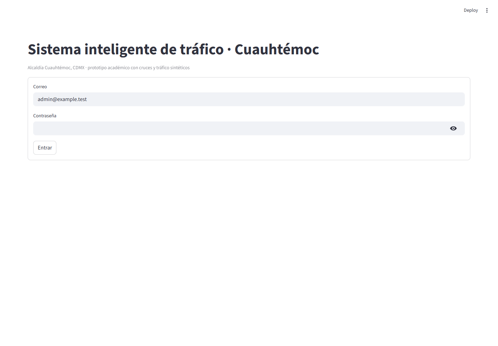
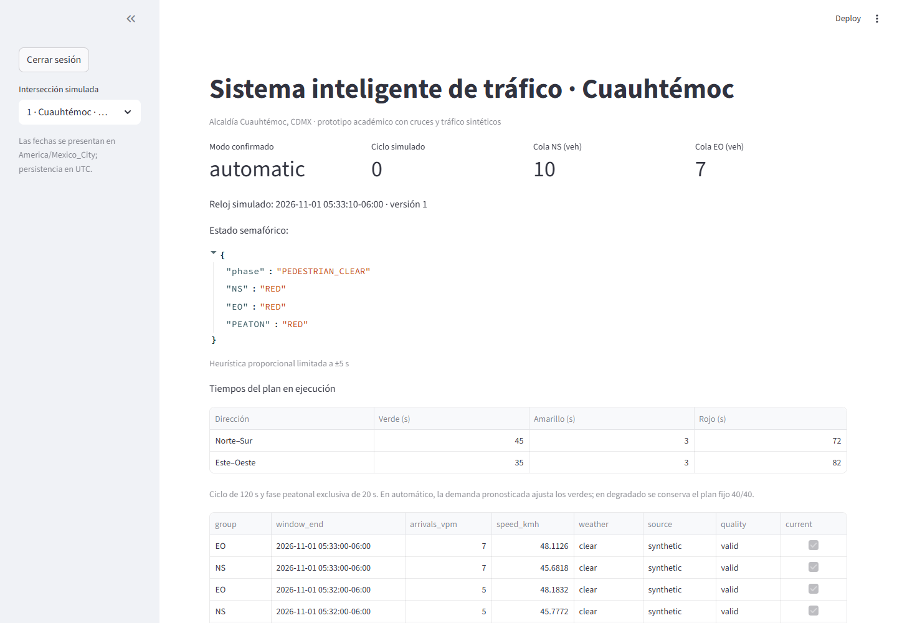
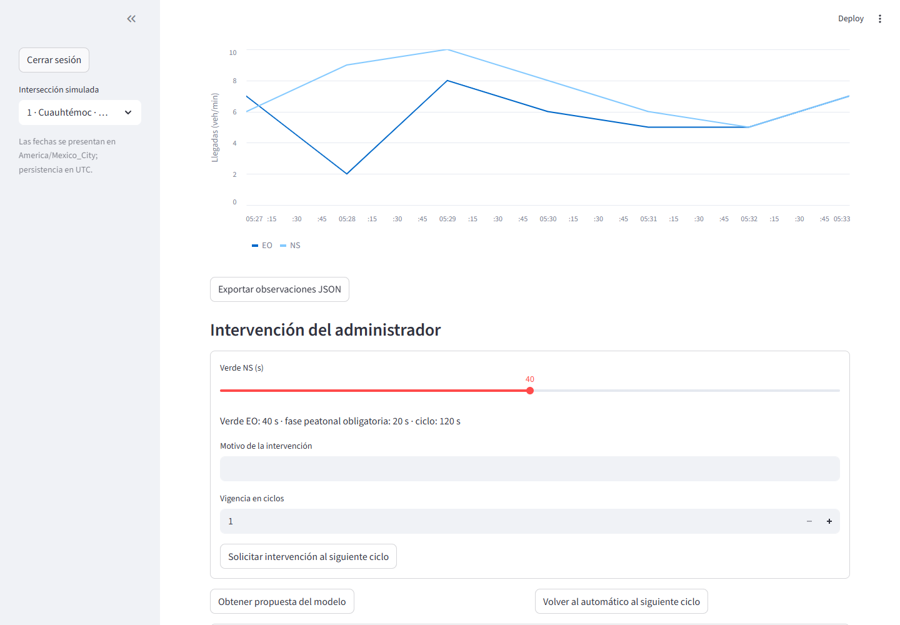
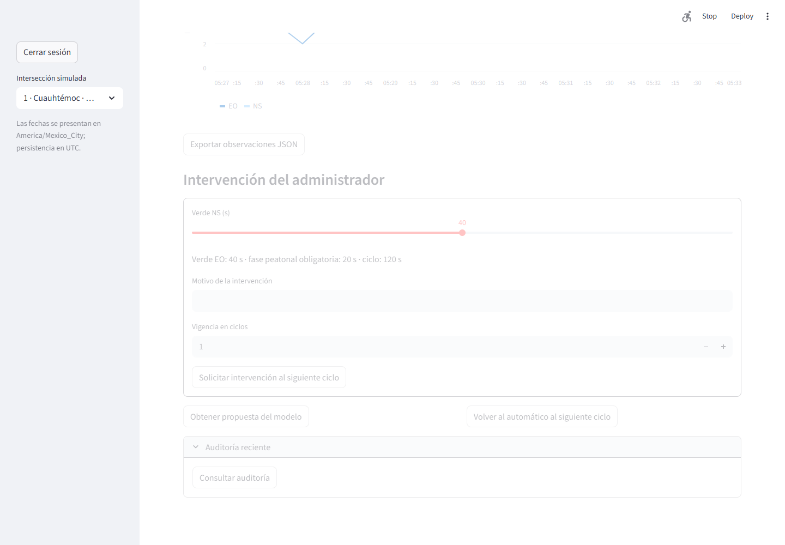

# DOC_003 Manual de instalación y usuario

Versión 1.0 · Cuauhtémoc · ENT_003 · 1 de noviembre de 2026.
Para el administrador y equipo de desarrollo. Todos los cruces, colas y semáforos son simulados.

## MAN_001 Requisitos previos

Python 3.13, equipo de desarrollo con 8 GB RAM mínimo y directorio del repositorio completo.
PostgreSQL es la base principal; SQLite permite demostración local sin servidor adicional.
Docker y Compose son opcionales. Acceso a internet solo para instalar dependencias o fuente
externa autorizada. GPU no requerida. No conectar el prototipo a infraestructura física.

## MAN_002 Instalación local en Windows

Abrir PowerShell en la raíz del repositorio. Ejecutar:

```powershell
python -m venv .venv
.\.venv\Scripts\python.exe -m pip install -r requirements.lock
.\.venv\Scripts\python.exe -m scripts.configure
.\.venv\Scripts\python.exe -m scripts.select_cuauhtemoc
.\.venv\Scripts\python.exe -m scripts.run_local
```

No cerrar esa terminal mientras se usa el sistema. Abrir http://127.0.0.1:8501 y verificar
http://127.0.0.1:8000/health. Swagger está en http://127.0.0.1:8000/docs; visitar / puede
devolver 404 porque no existe página de inicio de API. El lanzador inicia cuatro procesos y
comprueba puertos 8000, 8001 y 8501. No iniciar Uvicorn por separado al usar el lanzador.

El selector usa una BD nueva data/cuauhtemoc.db y conserva data/traffic.db. Si hay URL
personalizada, preparar una base nueva explícitamente en lugar de sobrescribir configuración.
Las capturas de este manual proceden de una instancia temporal con credenciales efímeras.

## MAN_003 Acceso

Consultar ADMIN_EMAIL y ADMIN_PASSWORD en .env; copiar solo el valor a la derecha del signo
igual, sin espacios ni comillas adicionales. La contraseña generada es larga; conservarla de
forma privada. No compartir .env. Pulsar Entrar. Una sesión vence tras una hora.
Modificar ADMIN_PASSWORD en .env no cambia por sí solo el hash de un usuario ya existente;
el inicializador solo crea usuarios ausentes. Para restablecer una cuenta existente se necesita
un procedimiento administrativo controlado, sin borrar la BD.



## MAN_004 Consultar circulación y tiempos

Elegir CUA_001 a CUA_005 en el menú lateral. Revisar reloj simulado, ciclo, modo confirmado,
colas NS/EO y colores con texto. La tabla indica verde, amarillo y rojo en segundos; el gráfico
presenta llegadas veh/min. La fecha de observación y la procedencia acompañan cada fila.
El reloj simulado puede avanzar más rápido que el real según SIM_SPEED. No comparar su
antigüedad con la hora del navegador para decidir si la fuente está vigente.



## MAN_005 Interpretar los modos

Automático: demanda pronosticada y control restringido. Manual: intervención validada vigente.
Degradado: plan fijo 40/40 por datos ausentes/vencidos, IA indisponible o recuperación.
Sin heartbeat por más de cinco segundos: estado desconocido; los colores antiguos no acreditan
la fase actual. La demanda puede modificar verdes, pero no suprime peatones ni transiciones.
Con NS=30 y EO=10 veh/min desde 40/40, el siguiente ciclo propone 45/35 por el límite de ±5 s.

## MAN_006 Pedir una propuesta

Pulsar Obtener propuesta del modelo. La respuesta muestra modo, motivo, demanda y tiempos.
PROPOSED significa que no se aplicó. Para solicitar aplicación mediante API usar POST
/plans/{id}/apply con previous_version y target_cycle de la propuesta. PENDING tampoco es
confirmación: esperar ACTIVE y applied_at. Si la versión cambió, refrescar antes de reintentar.
El trabajador genera también sus propias propuestas al decidir ciclos automáticamente.

## MAN_007 Intervención manual y retorno

Usar el deslizador de verde NS; EO es el complemento para sumar 80. Escribir un motivo
descriptivo de al menos cinco caracteres; seleccionar 1 a 10 ciclos y solicitar intervención.
Comprobar confirmación en un ciclo posterior. El modo degradado tiene precedencia: una
intervención no evita fallback por IA/fuente inválida. Pulsar Volver al automático para cancelar
la intervención desde el siguiente ciclo; la solicitud no cambia una fase a mitad.



## MAN_008 Exportación y auditoría

Exportar observaciones JSON descarga datos con fechas, unidades y procedencia. No hay CSV
arbitrario que permita fórmulas de hoja de cálculo. Abrir Auditoría reciente y pulsar Consultar
auditoría para ver actor, acción, antes/después, motivo y correlación. Viewer no puede escribir.



## MAN_009 Solución de errores

**TAB_DOC_003_MANUAL_001**

| ID | Mensaje | Acción |
|---|---|---|
| ERR_001 | Sin comunicación con API | Comprobar /health y reports/local/api.log; mantener lanzador abierto |
| ERR_002 | LocalProtocolError | Actualizar el código; el login no debe enviar Bearer vacío; recargar Ctrl+F5 |
| ERR_003 | Puerto ocupado / WinError 10048 | Detener ejecución anterior con Ctrl+C; no arrancar dos lanzadores; identificar PID antes de cerrar un proceso |
| ERR_004 | Credenciales inválidas / 401 | Comprobar valores de .env y cuenta existente; volver a iniciar sesión si venció |
| ERR_005 | 403 | Solicitar una cuenta con permiso administrativo para modificar |
| ERR_006 | 409 | Refrescar versión/ciclo; no repetir ciegamente aplicación antigua |
| ERR_007 | 422 | Revisar contrato, duración, sumas, motivo y zona horaria |
| ERR_008 | IA 503 / loaded=false | Revisar modelo promovido, hash, versión y reiniciar IA; fijo sigue disponible |
| ERR_009 | forrtl tras Ctrl+C | El mensaje corresponde al cierre de librerías numéricas; comprobar que los puertos queden libres antes de reiniciar |
| ERR_010 | Trabajador sin telemetría | Revisar worker.log y lease; reiniciar desde despeje, no asumir color anterior |

Para diagnosticar un puerto usar netstat -ano, sin cerrar procesos desconocidos. Los registros
no deben contener contraseñas/tokens. Los servicios de prueba usan otros puertos y credenciales.

## MAN_010 Instalación PostgreSQL o Compose

Crear BD nueva de laboratorio y configurar DATABASE_URL con postgresql+psycopg. Ejecutar
database.manage con propietario para migrar, luego usar traffic_app con permisos restringidos
de database/runtime_permissions.sql. APP_DB_PASSWORD permite provisionar ese rol en el
inicializador. Codificar caracteres reservados si se usan contraseñas manuales en una URL.
En Compose ejecutar docker compose up --build; el inicializador usa propietario y runtime
rol restringido. Solo dashboard/API se publican en localhost; BD/IA permanecen internos.
Para exposición externa se requiere TLS, acceso de red y revisión de seguridad adicionales.

## MAN_011 Entrenamiento promoción y reversión

```text
python -m ml_model.train_model --days 90 --seed 42
python -m ml_model.evaluate VERSION
python -m ml_model.promote VERSION --experiment reports/experiment.json --author NOMBRE_IA --reviewer NOMBRE_QA --reason REVISION_REAL_DOCUMENTADA
```

VERSION es el identificador impreso al entrenar. Revisores diferentes deben ser personas reales,
no nombres inventados. Reiniciar IA para cargar el modelo elegido. Revertir usa una versión
previa con su evidencia y motivo. No cargar artefactos de origen desconocido ni modificar modelos
en caliente. El nuevo alcance territorial no convierte modelos sintéticos en modelos calibrados.

## MAN_012 Respaldo recuperación y retiro

Ejecutar scripts.backup con pg_dump autorizado. Copiar también manifiestos y configuración
protegida. Restaurar con pg_restore --no-owner --no-acl a una BD nueva vacía, sin --clean;
comparar conteos/hashes y medir tiempo antes de cambiar URL. Ver DOC_004 PRU_009.
El ensayo de laboratorio no sustituye una política diaria de respaldos ni RTO integral de operación.
Detener con Ctrl+C. docker compose down conserva volumen; no borrar datos sin decisión explícita.
Reiniciar trabajador desde diez segundos de despeje. Revocar credenciales al retirar el prototipo.
